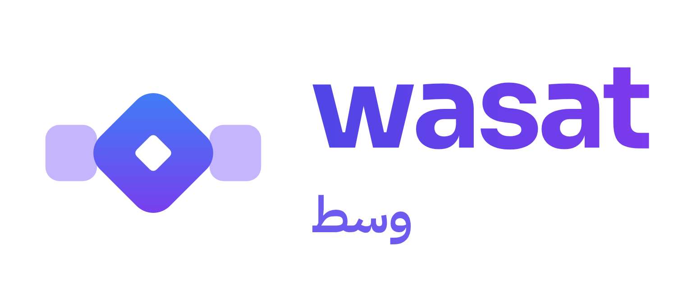
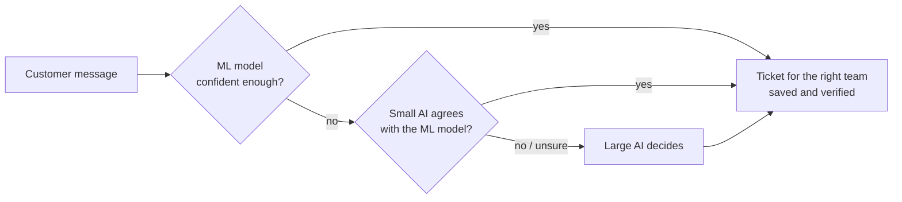

<div align="center">



# WASAT · وسط

**The right amount of AI for the right task.**

A resource-aware AI strategy that answers routine customer messages with a lightweight ML model
and calls AI only when a message actually needs it.

[](https://www.python.org/)
[](https://scikit-learn.org/)
[](https://streamlit.io/)
[](https://openrouter.ai/)
[](test_wasat.py)

**[Live demo](https://wasat0.streamlit.app/)** · **[Test report](RESULTS.md)**

*Misk × HUMAIN Future AI Builders Hackathon · Challenge 2: Deliver AI with Less Compute*

</div>

---

## Results at a glance

Evaluated on **275 held-out customer messages** (never used for training), with real costs reported by OpenRouter:

| | Large AI only | **WASAT** | Change |
|---|---:|---:|---:|
| Accuracy | 95.6% | **99.3%** | +3.7 pts |
| AI calls | 275 | **11** | −96% |
| Tokens | 92,244 | **1,904** | −97.9% |
| Cost (USD) | $0.0193 | **$0.00015** | −99.2% |
| Average response time | 3.56 s | **0.04 s** | ~94× faster |

On **30 synthetic messages** written outside the dataset (typos, slang, unclear wording), the ML model alone
drops to 76.7%. WASAT notices these messages are unfamiliar, sends more of them to AI, and matches the large
model's **96.7%** accuracy at **88% lower cost**.

Full test report: [RESULTS.md](RESULTS.md)

---

## The problem

Many companies now send **every** customer message to a large AI model, even simple ones such as
*"where is my package?"*. Most of these messages are routine, so a large share of the tokens, time and
money spent on AI is unnecessary.

## The idea

**Hypothesis:** companies can handle simple customer-service tasks with smaller, cheaper models and reserve
powerful AI for complex tasks, maintaining the same accuracy while reducing AI calls, tokens, cost and
response time.

WASAT (Arabic for *"the balanced middle"*) puts a decision layer in front of AI and routes each message
to the cheapest level that can handle it reliably:

| Message | Handled by | Cost |
|---|---|---|
| Simple, familiar | ML model (TF-IDF + logistic regression) | 0 tokens, ~1 ms |
| Unclear | Small AI · Llama 3.2 3B | Low, short prompt |
| Hard or disputed | Large AI · Llama 3.3 70B | Only when needed |

---

## How it works



**Design choices, mapped to the challenge goals**

| Challenge goal | How WASAT does it |
|---|---|
| Model choice per task | ML model first, small AI for unclear messages, large AI only for hard or disputed ones |
| Context that earns its tokens | WASAT's prompt contains only the message and the 11 categories, with a tiny JSON answer (20 tokens max). No chat history, no policy text |
| Verification where it pays | Every AI answer is validated; the small AI's answer counts only if it agrees with the ML model; refund, payment and cancel messages need 90% confidence instead of 80%; every ticket is verified by re-reading it |
| Cost per successful task | A task succeeds only with the right category **and** a verified ticket; failed runs still count as cost |
| Accuracy and latency floors | Results are checked against floors (≥ 90% accuracy, p95 latency ≤ 10 s) |

If the AI service goes down, WASAT keeps answering with the ML model's best guess instead of failing.

---

## Quick start

```bash
git clone https://github.com/Samm-006/WASAT.git
cd WASAT
python3 -m venv .venv && source .venv/bin/activate
pip install -r requirements.txt
cp .env.example .env              # add your OpenRouter API key
```

```bash
streamlit run app.py              # open the app
```

The trained model, test sets and saved AI answers are included, so the app and every result work
immediately. An API key is only needed for messages that are not already cached.

**Reproduce the results**

```bash
python3 prepare_data.py           # download Bitext, hold out the test set, train the ML model
python3 evaluate.py               # WASAT vs Large AI only on 275 held-out messages
python3 experiments.py            # ablation, threshold trade-off, writing styles, robustness
python3 -m unittest test_wasat -v # 17 unit tests, no internet or API key needed
```

AI answers are cached in `results/llm_cache.json`, so re-running reproduces the reported numbers without new
API costs. Use `python3 evaluate.py --no-cache` to call the models again.

---

## The app

| Tab | What it shows |
|---|---|
| **Live demo** | 10 random test messages answered by WASAT and Large AI only, side by side, with running totals |
| **Try it** | Type any message and see which step answers it, with tokens, time and the ticket created |
| **Results** | The full evaluation on all 275 test messages, with running token and cost charts |
| **Robustness tests** | The 30 synthetic messages, compared across Large AI only, ML model only and WASAT |

---

## Project structure

```
WASAT/
├── app.py              Streamlit app
├── wasat.py            The router: ML model → small AI → large AI, plus the baseline
├── llm.py              OpenRouter calls with token, latency and real-cost tracking, and caching
├── actions.py          Creates and verifies a ticket for the right team
├── config.py           Models, thresholds and floors (overridable in .env)
├── prepare_data.py     Downloads Bitext, holds out the test set, trains the ML model
├── evaluate.py         Main comparison on 275 held-out messages
├── experiments.py      Ablation, trade-off, writing styles, robustness tests
├── test_wasat.py       Unit tests
├── data/               Held-out test set, synthetic test set, dataset notice
├── results/            Trained model, saved results, cached AI answers
└── assets/             Logo
```

---

## Data

- **Bitext Customer Support** dataset: 26,872 messages across 11 categories (account, cancel, contact,
  delivery, feedback, invoice, order, payment, refund, shipping, subscription).
- **Split:** 25 messages per category held out for testing (275 total, seed 7); the remaining 26,597 train the ML model.
- **Robustness test:** 30 synthetic messages generated with AI assistance and labelled by hand
  (`data/stress_test.json`). They are not from the Bitext dataset and were never used for training.

Licence: [CDLA-Sharing-1.0](https://cdla.dev/sharing-1-0/) ·
[Source](https://huggingface.co/datasets/bitext/Bitext-customer-support-llm-chatbot-training-dataset) ·
see [data/BITEXT_NOTICE.md](data/BITEXT_NOTICE.md)

---

## Limitations and future work

**Limitations**
- Bitext messages are templated, so the ML model performs better than it would on real traffic.
- The robustness test uses 30 synthetic messages, a small sample.
- English only, one message at a time (no conversation history).
- Energy was not measured directly; we measured tokens, AI calls, cost and time.

**Future work**
- Test on real customer messages and a larger synthetic set.
- Retrain the ML model on messages AI resolved, so fewer messages need AI over time.
- Arabic and English support.
- Apply the same strategy to other workflows, such as HR, IT and finance requests.

---

## Author

**Sama Sultan A Alzahrani** · BSc Artificial Intelligence and Computer Science, University of Birmingham
